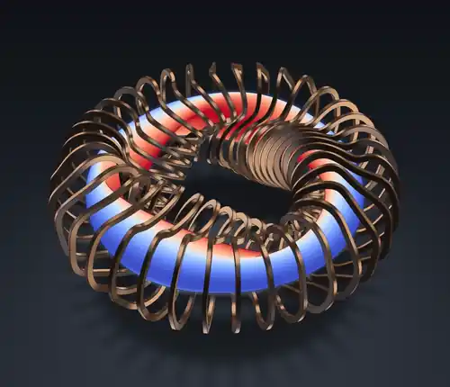

<p align="center">
  
  <br>
  <em>An nfp 3 configuration optimized tokamak → QA → QI → QH → QA, each with filamentary coils
  (|B| from the coils on the boundary).</em>
</p>


# qss-filaments (QSS)

QSS designs a stellarator plasma and its coils together. It optimizes the plasma boundary for quasi-symmetry (QS) or
quasi-isodynamicity (QI) under physics constraints (aspect ratio, rotational transform, well, mirror ratio, max-J,
Mercier, ...), and for every candidate boundary it re-solves a set of filament coils under hard engineering limits
(length, curvature, distances, ordering, force) and keeps the best coil fit as a constraint. The result is a
plasma that real coils can make, plus certified coils, in one run.

Equilibria: [VMEX](https://github.com/uwplasma/VMEX) (JAX VMEC). Coils:
[XCoil](https://github.com/PedroFranciscoGil/XCoil). Optimizer: the PHR augmented Lagrangian with exact
gradients (`phrport`). Paper: P. F. Gil, L. Fu, A. A. Kaptanoglu, *Single-Shot Single-Stage Stellarators*
(in preparation).

---

## 1. Install

**Laptop or workstation** (Python 3.11-3.13, CPU or one GPU):

```bash
git clone https://github.com/PedroFranciscoGil/qss-filaments.git
```

```bash
cd qss-filaments && python3.12 -m venv .venv && . .venv/bin/activate
```

```bash
pip install -e ".[test]"
```

```bash
qss-check
```

`qss-check` must end with `OK`. The install pins VMEX to the commit of the paper runs and XCoil to a commit; on Linux with an NVIDIA GPU
use `pip install -e ".[cuda,test]"`.

**Cluster (Slurm)**: the same four commands in your project space (put the venv on a fast file system). Then
submit with the template, see section 4.

## 2. Your first run (2 minutes on a laptop)

```bash
qss-run --profile examples/qa_vacuum_tiny.json --preset tiny --run-dir runs/first
```

It optimizes a quasi-axisymmetric boundary (aspect 6, iota 0.42, magnetic well) together with 16 coils, at
laptop resolution. The last lines of the output look like

```
Final: QS=5.49e-04 aspect=5.9994 iota=0.4194 c0_local=8.80e-05
```

and `runs/first/` contains:

| file | what it is |
|---|---|
| `final_metrics.json` | the result: QS, aspect, iota, well, every constraint value (`surface.g_eq`, feasible when <= 0), coil metrics (`coils.squared_flux_Jf`, `avg_Bn_over_B`, lengths, distances, `certified`) |
| `final_coils.json` | the coils (Fourier coefficients and currents, with a ready simsopt loader snippet) |
| `wout_optimized.nc` | the final equilibrium (VMEC format) |
| `al1_checkpoint_*.json` | checkpoints (resume from them) |
| `phr_port.log` | the full log |

Certify the coils of the final boundary (cold starts, then a warm polish until every limit holds to 1e-5):

```bash
qss-coils --profile examples/qa_vacuum_tiny.json --run-dir runs/first --out runs/first/coils_certified
```

## 3. How a run works

```text
   profile.json                       qss-run options                         runs/<name>/
   what to design                     how to run it                           what you get
 ┌──────────────────────┐   ┌──────────────────────────────────┐   ┌─────────────────────────────────┐
 │ equilibrium: seed    │   │ --preset production | tiny       │   │ final_metrics.json  (results)   │
 │   deck, QS / QI,     │   │   (solver settings of the        │   │ final_coils.json    (coils)     │
 │   resolution         │──▶│    published runs, or a smoke    │──▶│ wout_optimized.nc   (equilib.)  │
 │ phr: plasma targets  │   │    test)                         │   │ al1_checkpoint_*    (resume)    │
 │ coils: coil limits   │   │ --n-continuation-steps, ...      │   │ phr_port.log        (log)       │
 │ run: run length      │   │ (or the profile's "run" section) │   └─────────────────────────────────┘
 └──────────────────────┘   └──────────────────────────────────┘     then: qss-coils (certified coils)
```

* The **profile** ([docs/profile.md](docs/profile.md)) is one JSON file: the seed equilibrium deck, the objective,
  the plasma constraints, the coil set and its limits, and optionally the run length.
* The **preset** sets the solver options: `production` = the settings of the published runs (exact Jacobian, flux scale 500,
  anchored coil oracle, speed-ups), `tiny` = a few-minute smoke test.
* **Command-line flags** override both. Priority: defaults < profile < preset < profile `"run"` section <
  command line.
* Inside the run, a **continuation** frees the boundary Fourier modes step by step (modes 1, 2, ..., N). At each
  step the augmented Lagrangian alternates boundary least-squares solves with multiplier updates. Every evaluation
  solves VMEX and the coil problem; the coil fit's gradient enters through the envelope theorem. The coil fit bound
  tightens at every step (by default to 0.5 x the fit achieved at the step's start).

## 4. What you submit

**On a laptop**: the profile and one command.

```bash
qss-run --profile examples/qa_vacuum.json --preset production --run-dir runs/qa_vac
```

**On a Slurm cluster (e.g. Tillicum)**: the profile, the job template and two variables. Edit the `#SBATCH`
lines of `tools/slurm/qss_run.slurm` (partition, account, time) once, then

```bash
PROFILE=examples/qa_vacuum.json RUN=qa_vac sbatch tools/slurm/qss_run.slurm
```

The job runs `qss-run --preset production` into `runs/qa_vac`, then writes the certified coils
(`runs/qa_vac/coils_certified.json`). Useful variables: `NSTEPS` (continuation steps), `NOUT` (outers per step),
`EXTRA="..."` (more options), `VENV` (the environment, default `./.venv`).

**Resume after a time limit or a crash**: submit the same command again. The job finds the newest checkpoint and
continues it in `runs/qa_vac_r2` (then `_r3`, ...) with the same flux bound and multipliers. By hand:

```bash
qss-run --profile examples/qa_vacuum.json --preset production --run-dir runs/qa_vac_r2 --resume-from runs/qa_vac/al1_checkpoint_latest.json --resume-keep-target
```

**Chain a new stage** (e.g. switch on Mercier or raise beta from step 4 on): a new profile and
`RESUME_FROM=runs/qa_vac/al1_checkpoint_final.json START_STEP=4` (tutorial 5).

**Start from a tokamak, a wout, a boundary file or an old run, or from your own coils**: make a seed deck with
`qss-seed` and/or set `coils.seed_coils`, see [docs/seeding.md](docs/seeding.md). Tokamak starts:
`examples/qa_from_tokamak.json` and `examples/qi_maxj_mirror.json` (tutorial 6).

## 5. What matters for a run

| setting | where | default | when to change it |
|---|---|---|---|
| seed (starting boundary) | profile `equilibrium.input_file` (`qss-seed` makes decks) | `inputs/input.nfp2_QA` (a circular tokamak + rotating ellipse) | always; a tokamak seed needs a symmetry break and a flux bound floor ([seeding.md](docs/seeding.md)) |
| plasma targets: aspect, iota, elongation, well (QA); mirror, max-J, iota axis/edge (QI) | profile `phr` | PHR nfp2 QA values | always: they define the design ([constraints.md](docs/constraints.md)) |
| objective | profile `equilibrium.physics`, helicity / `qi_surfaces` | QS, QA | QH: `helicity_n = nfp`; QI: `"qi"` + `qi_options` |
| coil count and order | profile `coils.n_coils`, `order` | 4 per half period, order 5 | more coils = better fit but shorter, tighter coils; order 5-8 |
| coil limits: length, curvature, MSC, coil-coil, coil-plasma distance | profile `coils` | PHR (4 m, 3 /m, 4, 0.1 m, 0.15 m) | scale them to your device size (the deck's units) |
| extra coil limits: ordering gaps, Lp curvature, force | profile `coils.slot_rows`, `lp_curvature_max`, `max_force` | off | ordering for many coils per period; force only on a GPU |
| coil fit bound | `run.flux_target_frac` (`--flux-target-frac`), `flux_target_floor`, `flux_target_bn` | 0.5 x the fit at each step start | lower = coils closer to the plasma shape, at the cost of QS; a floor stops the bound from shrinking forever |
| continuation length | `run.n_continuation_steps`, `al_outer_iter` | 4 x 6 (paper 5 x 5, QI 7 x 5) | more steps = more boundary modes (finer shaping) and longer runs |
| inner budget | `--max-nfev` | 20 (paper 30) | larger for harder steps |
| resolution | profile `equilibrium.vmec_mpol`, `ns_array`, `surf_mpol/ntor`; `coils.phr_grid`, `qi_options` grids | PHR | raise for final designs; lower only in `_tiny` tests |
| finite beta | profile `phr.finite_beta`, `fb_field_sign`; `run.eq_jacobian: "exact"` | off | any design with pressure in the deck |
| hardware | `PHRPORT_VMEX_DEVICE=cpu` (VMEX on CPU, coils on GPU), `--n-workers` | all on the default device | GPU nodes: VMEX on the GPU for H100/H200, CPU for small GPUs; laptops: `--n-workers 2-6` |
| time | Slurm `--time`, `NSTEPS` x `NOUT` | 24 h | the paper's single-shot runs took about a GPU-hour each; QI with the max-J closure takes longer; resubmit to continue |

## 6. Where to go next

| | |
|---|---|
| [docs/profile.md](docs/profile.md) | the profile file, section by section, with annotated QA / finite-beta / QI examples |
| [docs/constraints.md](docs/constraints.md) | every constraint: definition, how to switch it on, paper values, enforcement, gradient, cost, pitfalls |
| [docs/reference.md](docs/reference.md) | every option (314, generated from the code): profile keys, flags, environment variables, defaults, units |
| [docs/seeding.md](docs/seeding.md) | the starting boundary (deck, tokamak, rotating ellipse, wout, boundary JSON, old run) and the starting coils |
| [docs/tutorials/](docs/tutorials/01_vacuum_qa.md) | 1 vacuum QA, 2 finite-beta QA, 3 QI with max-J / mirror, 4 XCoil coils and certification, 5 continuation, resume and clusters, 6 tokamak seed and coil seeds |
| [docs/xcoil.md](docs/xcoil.md) | the coil backend: selection, devices, certification |
| [docs/troubleshooting.md](docs/troubleshooting.md) | common failures and what to do |

## Repository layout

| path | content |
|---|---|
| `phrport/` | the optimizer: `phr.py` (outer loop), `equilibrium.py` (VMEX), `exact_jacobian.py`, `coils.py` (XCoil coil subproblem), `finite_beta.py`, `qi_residual.py`, `mercier.py`, `forces.py`, `problem.py` (profiles), `options.py` (option inventory), `backend.py`, `cli.py` |
| `examples/`, `inputs/` | example profiles (each with a `_tiny` laptop variant) and their VMEC decks |
| `tools/` | post-processing and checks (free boundary, DESC, Taylor tests, VTK export), `gen_reference.py`, Slurm templates |
| `tests/` | pytest suite (CPU) |

## Tests

```bash
pytest
```

About a minute on a CPU (constraint rows, the optimizer loop on stubs, QI kernels, certified XCoil solves, the
option dictionary). `QSS_RUN_SLOW=1 pytest` adds tutorial 1 end to end. GitHub Actions (`.github/workflows/ci.yml`) runs the
same on every push.

## License

MIT (see [LICENSE](LICENSE)), Copyright (c) 2026 Pedro Francisco Gil, Lanke Fu and Alan A. Kaptanoglu. Parts of
`phrport` are derived from SciPy (BSD-3-Clause), simsopt (MIT) and VMEX (MIT); their notices are in
[THIRD_PARTY_NOTICES.md](THIRD_PARTY_NOTICES.md). Dependencies keep their own licenses (XCoil: MIT, Pedro Francisco
Gil and Alan A. Kaptanoglu; VMEX: MIT; virtual-casing-jax: Apache-2.0).
